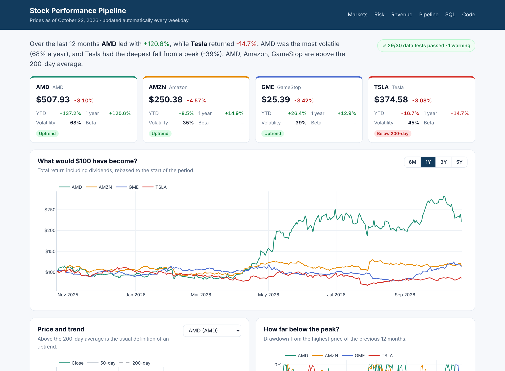
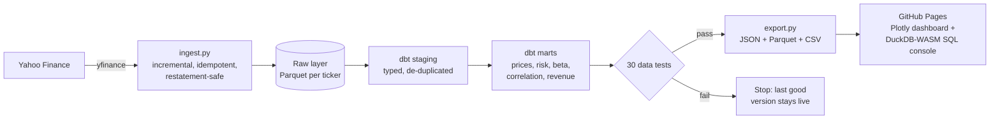
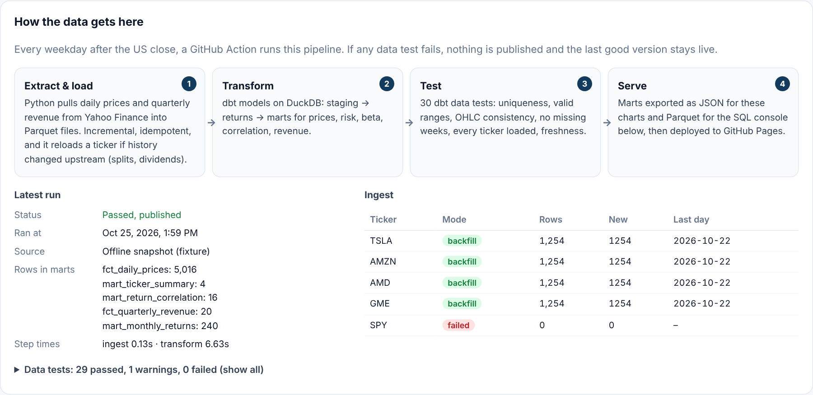

# Stock Performance Pipeline

A self-updating dashboard for **Tesla, Amazon, AMD and GameStop against the S&P 500**, built on a small but complete data pipeline: incremental ingestion, dbt models on DuckDB, 30 data tests that gate every publish, and a SQL console that queries the warehouse in your browser.

**Live dashboard:** https://phanisrikanth9.github.io/Analyzing-Stock-Performance-and-Building-a-Dashboard/



## Architecture



Orchestrated by GitHub Actions every weekday after the US close (`.github/workflows/pipeline.yml`): unit + regression tests → ingest → `dbt build` → export → deploy. A failing data test fails the job before deployment.

## Engineering decisions

**Ingestion (`pipeline/ingest.py`)**
- *Incremental*: once a ticker has history, only the last 7 days are fetched; the overlap is upserted on `(ticker, date)`.
- *Idempotent*: running twice on the same day changes nothing (tested).
- *Restatement-safe*: Yahoo rewrites history after splits and dividends. If prices in the overlap window disagree with what's stored by more than 0.01%, the ticker is reloaded from scratch instead of silently mixing two price bases (tested with a simulated 2-for-1 split).
- *Failure-isolated and atomic*: one ticker failing is recorded and the rest continue; files are written to a temp path and renamed, so a crash never leaves a half-written file.
- *Rolling window*: the raw layer keeps 5 years, so it doesn't grow forever.

**Transformation (`transform/`, dbt + DuckDB)**

| Layer | Models |
|---|---|
| Staging | `stg_prices`, `stg_revenue`, `stg_tickers` (seeded from `config/tickers.yml`) |
| Intermediate | `int_daily_returns` (total returns from dividend-adjusted closes) |
| Marts | `fct_daily_prices` (MA50/200, 252-day drawdown, 63-day volatility, growth of $100), `mart_ticker_summary` (YTD, 1-year, 3-year CAGR, volatility, max drawdown, beta vs SPY, return per risk), `mart_return_correlation`, `mart_monthly_returns`, `fct_quarterly_revenue` (QoQ and YoY growth) |

**Data quality (30 tests)**: key uniqueness on every fact table, foreign keys to the ticker dimension, value ranges (positive prices, returns within ±100%, drawdown ≤ 0, correlation in [−1, 1]), OHLC consistency (low ≤ open/close ≤ high), no future dates, no gap longer than a week, every configured ticker loaded, all tickers updated to the same day, and source freshness (warn after 4 days, error after 7).

**Serving**: marts are exported as compact JSON for the charts and as Parquet/CSV for the in-browser SQL console. DuckDB-WASM (~8 MB) loads only when someone opens the console.

**Adding a stock** is a one-line change in `config/tickers.yml`: ingest backfills it, dbt and the tests pick it up, the dashboard shows it.

## Validation

The previous version of this project computed the same metrics with pandas. On a real snapshot of Yahoo data from 2026-10-22 (`tests/fixtures/`), the SQL marts reproduce its published YTD, 1-year return, volatility, max drawdown, distance from the 52-week high and last close for all four stocks (`tests/test_pipeline_fixture.py`, run in CI). Writing that test found a real definition bug: the first draft measured max drawdown from a rolling 252-day peak that could fall *before* the 12-month window; it now uses the standard peak-to-trough inside the window.



## Run it

```bash
pip install -r requirements.txt
python -m pipeline.run                    # real data (needs internet)
python -m pipeline.run --source fixture   # offline: the 2026-10-22 snapshot
python -m pytest -q tests                 # 14 tests: ingest behaviour + end-to-end regression

cd site && npm install && npm run dev     # dashboard at http://localhost:5173/...
```

## Project layout

| Path | What it is |
|---|---|
| `config/tickers.yml` | The universe and benchmark |
| `pipeline/` | `sources.py` (Yahoo + offline fixture), `ingest.py`, `run.py` (orchestrator), `export.py` |
| `transform/` | dbt project: models, generic and singular tests |
| `warehouse/raw/` | Raw Parquet layer, committed by the pipeline bot |
| `site/` | Vite + TypeScript dashboard, Plotly charts, DuckDB-WASM console |
| `tests/` | pytest suite and the real-data fixture |
| `course_project/` | The original IBM course assignment this grew from |

## History

Started as the final assignment of IBM's *Python Project for Data Science* (Coursera): scrape Tesla and GameStop revenue with BeautifulSoup and plot it ([`course_project/ibm_assignment.py`](course_project/ibm_assignment.py)). Version 1 added more stocks, risk metrics and a daily-rebuilt Plotly page. Version 2 (this) turns it into a tested ELT pipeline with a warehouse you can query.

Not investment advice. Built by [Phani Srikanth Samayam](https://phanisrikanth9.github.io/Phani-Portfolio/).
